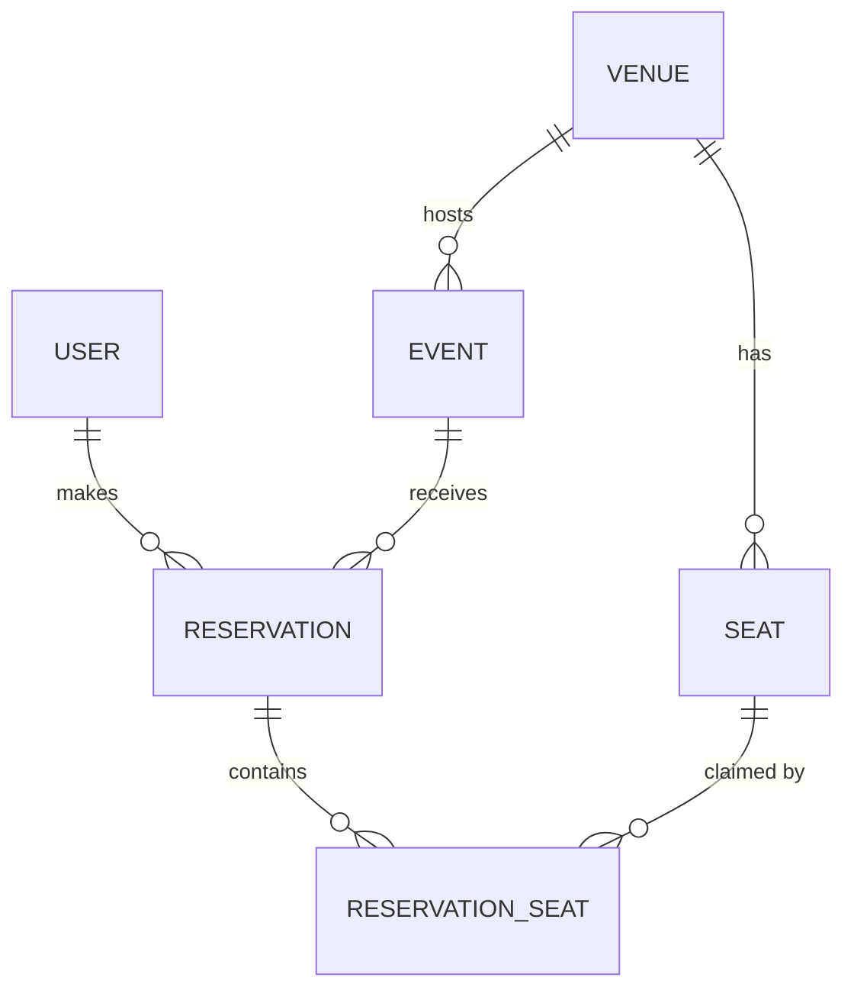

# Halcyon Ticketing API

Event ticketing and seat reservation backend for ticket **HS-2026-0872**.
Django 5.2 · Django REST Framework · PostgreSQL 16 · JWT auth · Docker · GitHub Actions.

Admins publish events at venues with mapped seats. Standard users hold seats, confirm, or cancel.
Double-booking is prevented by the database itself, not only by application checks.

## Contents

1. [Quick start (docker compose)](#quick-start)
2. [Local development without Docker](#local-development)
3. [Architecture and data model](#architecture)
4. [Authentication and roles](#authentication-and-roles)
5. [API reference and cURL samples](#api-reference)
6. [Error schema](#error-schema)
7. [Database index choices](#database-index-choices)
8. [Testing, linting and CI](#testing-linting-and-ci)
9. [Docker notes](#docker-notes)
10. [Configuration](#configuration)
11. [Known limitations](#known-limitations)

## Quick start

Requirements: Docker with the Compose plugin.

```bash
git clone <repo-url> halcyon-ticketing && cd halcyon-ticketing
docker compose up --build
```

The stack starts PostgreSQL, waits for it to be healthy, applies migrations and seeds demo data.
Then open:

| What | URL |
| --- | --- |
| Swagger UI | http://localhost:8000/api/docs/ |
| ReDoc | http://localhost:8000/api/redoc/ |
| OpenAPI schema | http://localhost:8000/api/schema/ |
| Health | http://localhost:8000/health/ |

Demo accounts (created by `seed_demo`, **development only**):

| Role | Username | Password |
| --- | --- | --- |
| Admin | `admin` | `Admin#Demo2026` |
| Standard user | `alice` | `User#Demo2026` |

Set `SEED_DEMO_DATA=0` to skip seeding, and override `SEED_ADMIN_PASSWORD` / `SEED_USER_PASSWORD` if
the stack is reachable by anyone else. Stop with `docker compose down` (add `-v` to wipe the database).

## Local development

```bash
python -m venv .venv && source .venv/bin/activate
pip install -r requirements-dev.txt
pytest                      # uses SQLite when POSTGRES_DB is unset
```

To develop against PostgreSQL, run only the database (`docker compose up db`) and export:

```bash
export POSTGRES_DB=ticketing POSTGRES_USER=ticketing \
       POSTGRES_PASSWORD=ticketing_dev_password POSTGRES_HOST=localhost
python manage.py migrate && python manage.py seed_demo && python manage.py runserver
```

Note: compose does not publish the database port by default. Add `ports: ["5432:5432"]` to the `db`
service if you want to connect from the host.

## Architecture

```
config/      settings, root URLs, WSGI/ASGI
core/        error envelope, permissions, request-id middleware, /health/
accounts/    custom User model (role), registration, profile, user admin
ticketing/   venues, seats, events, reservations, booking services
tests/       pytest suite
docker/      container entrypoint
```



* **User**: `role` is `admin` or `user`. Superusers are always admins.
* **Venue / Seat**: a venue owns seats identified by `(section, row, number)` with a `price_multiplier`.
* **Event**: belongs to a venue, has a `base_price` and a `status` (`draft`, `published`, `cancelled`).
* **Reservation**: a user's booking for one event. Statuses are `pending` (seats held), `confirmed`, `cancelled`, `expired`.
* **ReservationSeat**: the many-to-many `through` table between reservations and seats. It snapshots the price at booking time.

Relationships use foreign keys (`Seat.venue`, `Event.venue`, `Reservation.user`, `Reservation.event`)
and a many-to-many (`Reservation.seats` through `ReservationSeat`).

### How double-booking is prevented

`ReservationSeat` has a **partial unique index** on `(event, seat) WHERE is_active`. Releasing a seat
(cancel, expiry) flips `is_active` to false, which frees it for rebooking while keeping history.

The booking service checks availability inside a transaction for a clean error message. If two requests
race past that check, the index rejects the loser and the API returns `409 seat_unavailable`.
This was verified against PostgreSQL with 20 simultaneous requests for one seat across 4 gunicorn
workers: exactly one `201`, nineteen `409`.

### Seat holds

Creating a reservation holds seats as `pending` for `RESERVATION_HOLD_MINUTES` (default 15). Confirm to
keep them. Lapsed holds are treated as available **at read time** (seat maps and capacity counts), and
are formally marked `expired` the next time someone books that event or tries to confirm the lapsed hold.
No background worker is required.

## Authentication and roles

JWT via `djangorestframework-simplejwt`: access tokens last 30 minutes, refresh tokens 1 day.

| Capability | Anonymous | Standard user | Admin |
| --- | --- | --- | --- |
| Register, log in, `/health/`, docs | yes | yes | yes |
| Read venues, seats, published events, seat maps | no | yes | yes |
| Read draft/cancelled events | no | no | yes |
| Create/update/delete venues, seats, events | no | no | yes |
| Create reservations; confirm/cancel/edit notes on **own** | no | yes | yes (any) |
| List/read reservations | no | own only | all |
| Hard-delete a cancelled/expired reservation | no | no | yes |
| Manage users (`/users/`) | no | no | yes |

Public registration always creates a standard user. Roles can only be changed by an admin.

## API reference

Base path `/api/v1/`. Full interactive documentation is generated by drf-spectacular at `/api/docs/`.

| Method and path | Purpose |
| --- | --- |
| `POST /auth/register/` | Create a standard account |
| `POST /auth/token/` · `POST /auth/token/refresh/` | Obtain / refresh JWTs |
| `GET, PATCH /auth/me/` | Own profile |
| `/users/` | Admin CRUD on users |
| `/venues/` | CRUD (admin write). `POST /venues/{id}/seats/generate/` bulk-creates a seat block |
| `/seats/` | CRUD (admin write). Filter by `venue`, `section`, `row` |
| `/events/` | CRUD (admin write). Filters: `venue`, `status`, `city`, `starts_after`, `starts_before`; `search`; `ordering` |
| `GET /events/{id}/seats/` | Seat map with live `is_available` (optional `?section=`) |
| `/reservations/` | `POST` create, `GET` list/retrieve, `PATCH` notes, `DELETE` admin hard-delete |
| `POST /reservations/{id}/confirm/` · `POST /reservations/{id}/cancel/` | Lifecycle |
| `GET /health/` | Status, uptime, database connectivity |

List endpoints are paginated (`?page=`, `?page_size=` where supported).

### cURL samples

These use the demo accounts and `jq` to pull values out of responses.

```bash
BASE=http://localhost:8000

# 1. Health (no auth). Returns 503 if the database is unreachable.
curl -s $BASE/health/ | jq

# 2. Log in as a standard user and keep the access token
TOKEN=$(curl -s -X POST $BASE/api/v1/auth/token/ \
  -H 'Content-Type: application/json' \
  -d '{"username":"alice","password":"User#Demo2026"}' | jq -r .access)

# 3. Register a new account
curl -s -X POST $BASE/api/v1/auth/register/ \
  -H 'Content-Type: application/json' \
  -d '{"username":"sam","email":"sam@example.com","password":"S0me-Strong#Pass"}' | jq

# 4. Browse events (filter by city, search, order)
curl -s "$BASE/api/v1/events/?city=Johannesburg&search=launch&ordering=starts_at" \
  -H "Authorization: Bearer $TOKEN" | jq

# 5. See which seats are free for event 1
curl -s "$BASE/api/v1/events/1/seats/?section=Floor" \
  -H "Authorization: Bearer $TOKEN" | jq '.results[:5]'

# 6. Hold two seats (all-or-nothing)
RES=$(curl -s -X POST $BASE/api/v1/reservations/ \
  -H "Authorization: Bearer $TOKEN" -H 'Content-Type: application/json' \
  -d '{"event":1,"seat_ids":[1,2],"notes":"Together please"}')
echo "$RES" | jq
RID=$(echo "$RES" | jq -r .id)

# 7. Confirm it (before the hold expires), or cancel it
curl -s -X POST $BASE/api/v1/reservations/$RID/confirm/ -H "Authorization: Bearer $TOKEN" | jq .status
curl -s -X POST $BASE/api/v1/reservations/$RID/cancel/  -H "Authorization: Bearer $TOKEN" | jq .status

# 8. Booking a taken seat returns 409 with the standard error envelope
curl -s -X POST $BASE/api/v1/reservations/ \
  -H "Authorization: Bearer $TOKEN" -H 'Content-Type: application/json' \
  -d '{"event":1,"seat_ids":[1]}' | jq

# 9. Admin: log in, create a venue, bulk-generate seats, publish an event
ADMIN=$(curl -s -X POST $BASE/api/v1/auth/token/ \
  -H 'Content-Type: application/json' \
  -d '{"username":"admin","password":"Admin#Demo2026"}' | jq -r .access)

VENUE=$(curl -s -X POST $BASE/api/v1/venues/ \
  -H "Authorization: Bearer $ADMIN" -H 'Content-Type: application/json' \
  -d '{"name":"Moses Mabhida Stadium","city":"Durban","capacity":100}' | jq -r .id)

curl -s -X POST $BASE/api/v1/venues/$VENUE/seats/generate/ \
  -H "Authorization: Bearer $ADMIN" -H 'Content-Type: application/json' \
  -d '{"section":"Main","rows":["A","B","C"],"seats_per_row":10,"price_multiplier":"1.50"}' | jq

curl -s -X POST $BASE/api/v1/events/ \
  -H "Authorization: Bearer $ADMIN" -H 'Content-Type: application/json' \
  -d "{\"venue\":$VENUE,\"title\":\"Summer Concert\",\"starts_at\":\"2027-02-01T18:00:00Z\",\"ends_at\":\"2027-02-01T21:00:00Z\",\"base_price\":\"400.00\",\"status\":\"published\"}" | jq

# 10. A standard user attempting an admin action gets 403
curl -s -X POST $BASE/api/v1/venues/ \
  -H "Authorization: Bearer $TOKEN" -H 'Content-Type: application/json' \
  -d '{"name":"X","city":"Y","capacity":1}' | jq
```

## Error schema

Every error, whether from validation, authentication, permissions, a missing route or an unexpected
exception, has the same shape:

```json
{
  "error": {
    "code": "seat_unavailable",
    "message": "One or more requested seats are no longer available.",
    "status": 409,
    "details": { "seat_ids": [1] },
    "request_id": "9c1f0b6e2a7d4e0f8a53c2d1b4e67f90"
  }
}
```

`code` is stable and machine-readable (`validation_error`, `not_authenticated`, `permission_denied`,
`not_found`, `conflict`, `seat_unavailable`, `hold_expired`, `invalid_state`, `event_closed`,
`protected`, `server_error`, and so on). `details` carries field errors for validation failures
and extra context for conflicts, otherwise `null`. `request_id` matches the `X-Request-ID` response
header; send your own `X-Request-ID` to correlate with client logs. Unexpected 500s never leak
internals; the traceback goes to the server log only.

## Database index choices

Indexes cost write time and storage, so each one below exists to serve a specific query.

| Index / constraint | Serves | Why this shape |
| --- | --- | --- |
| `ReservationSeat` unique `(event, seat)` **where `is_active`** | Double-booking prevention; "is this seat taken for this event?" | Partial: only live claims are indexed, so it stays small and cancelled history never blocks rebooking. It doubles as the lookup index for availability checks. |
| `Seat` unique `(venue, section, row, number)` | Seat identity; seat map per venue; `?venue=` and `?section=` filters | Leading column `venue` means the same index serves "all seats in a venue" and "venue + section", so no extra index is needed. |
| `Event` `(status, starts_at)` | Public listing: published events, soonest first, `starts_after` / `starts_before` | Equality on `status` then a range/sort on `starts_at` lets the planner return rows already in order. |
| `Event` `(venue, starts_at)` | Venue calendar; filtering events by venue | Equality on `venue` then range on `starts_at`. |
| `Reservation` `(user, -created_at)` | "My reservations", newest first (the default list for standard users) | Matches the filter and sort of the most frequent read in the system. |
| `Reservation` `(event, status)` | Cascade on event cancellation; per-event reservation counts | Both queries filter by event then status. |
| `Reservation` `(status, expires_at)` | Expiry sweep: pending reservations whose hold has lapsed | Equality then range, so the sweep touches only pending rows. |
| `Venue` `(city)` | `?city=` filter | Low write volume, frequent filter. |
| `User.role`, `User.email` (unique), `Reservation.reference` (unique) | Role-filtered user lists, login/uniqueness, public booking reference | Unique constraints are indexes. `role` is indexed for admin filtering. |

Deliberately not indexed: free-text `search` uses `icontains`, which a b-tree index cannot accelerate.
At this scale that is fine; at larger scale the next step would be a `pg_trgm` GIN index or full-text
search. Foreign keys get Django's default single-column index. Query plans depend on data volume (on tiny
tables PostgreSQL will choose sequential scans), so re-check with `EXPLAIN ANALYZE` against realistic data.

Database `CHECK` constraints back up validation (event ends after it starts, prices and capacities are
non-negative or positive, seat numbers are positive), so bad data cannot get in via the admin or scripts either.

## Testing, linting and CI

```bash
pytest --cov --cov-report=term-missing --cov-fail-under=80   # tests + coverage gate
flake8 . && black --check .                                  # lint
python manage.py spectacular --validate --fail-on-warn --file /dev/null   # OpenAPI check
```

The suite has 122 tests covering every endpoint, role permissions, error envelope, booking edge cases
(conflicts, expiry, cancellation, event cancellation cascade), model constraints, the health check
including database failure, and the seed command. Coverage at the time of writing: 99.7%.
The tests pass on both SQLite and PostgreSQL 16.

`.github/workflows/ci.yml` runs on every push and pull request:

1. **lint**: `flake8` and `black --check`.
2. **test** (needs lint): starts a PostgreSQL 16 service container, checks that migrations are committed,
   validates the OpenAPI schema, then runs `pytest` with a **80% coverage gate**. pytest-django creates
   and drops a temporary `test_ticketing` database each run. Coverage XML is uploaded as an artifact.
3. **docker** (needs test): builds the image with Buildx and layer caching, starts the full compose stack
   from that image, `curl`s `/health/`, and tears it down. On `main`, if `DOCKERHUB_USERNAME` and
   `DOCKERHUB_TOKEN` secrets exist, it pushes `latest` and the commit SHA to Docker Hub.

## Docker notes

* **Multi-stage**: the builder stage creates a virtualenv with pinned dependencies; the runtime stage copies
  only that virtualenv and the application code. No build tooling or pip cache ships.
* `requirements.txt` is copied first so dependency layers are cached until dependencies change.
* Runs as a non-root user, has a `HEALTHCHECK` against `/health/`, and starts through `docker/entrypoint.sh`
  (optional migrate and seed, then `gunicorn`).
* Compose gates the web container on the database's `pg_isready` healthcheck, so migrations never race it.

## Configuration

| Variable | Default | Purpose |
| --- | --- | --- |
| `DJANGO_SECRET_KEY` | insecure dev key | Signing key. **Required** when `DJANGO_ENV=production` (startup fails otherwise) |
| `DJANGO_ENV` | `development` | Set `production` to enforce the secret key check |
| `DJANGO_DEBUG` | `false` | Django debug mode |
| `DJANGO_ALLOWED_HOSTS` | localhost set | Comma-separated hosts |
| `POSTGRES_DB` `_USER` `_PASSWORD` `_HOST` `_PORT` | none | PostgreSQL connection. If `POSTGRES_DB` is unset, SQLite is used |
| `RESERVATION_HOLD_MINUTES` | `15` | How long pending seats are held |
| `MAX_SEATS_PER_RESERVATION` | `10` | Per-booking seat cap |
| `RUN_MIGRATIONS` / `SEED_DEMO_DATA` | `1` / `0` (`1` in compose) | Container startup behaviour |

See `.env.example`.

## Known limitations

Being explicit about what this service does not do:

* **No payments.** "Confirmed" means the user confirmed within the hold window; there is no payment provider.
* **No rate limiting.** Login and registration are not throttled; put the service behind a gateway or add DRF throttling before exposing it publicly.
* **No refresh-token blacklist.** Logout is client-side; tokens expire naturally.
* **Search is `icontains`** (see index notes).
* **Expired holds are cleaned lazily**, not by a scheduler. Behaviour is correct, but `expired` rows are only written when touched.
* **Demo seed credentials are public** and for development only.
* Static files for the Django admin are not served by the container (the API and Swagger UI do not need them; Swagger loads its assets from a CDN).
